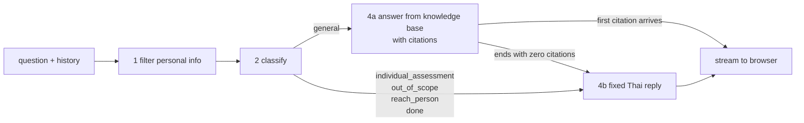
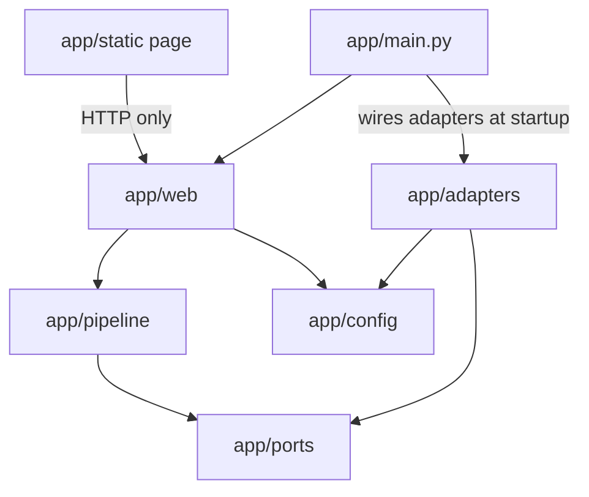
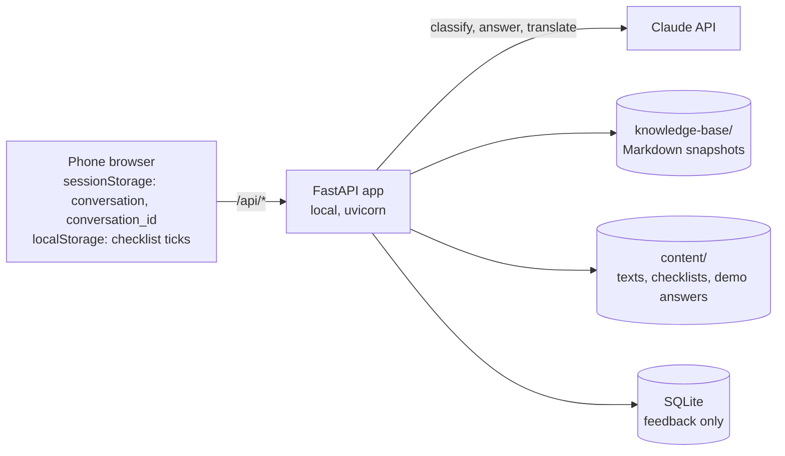

# Architecture Spine — Norway Visa Guide For Thai

## Design Paradigm

**Request pipeline with ports and adapters.** Every chat message passes through the same fixed steps in a fixed order. Each step has one job. External services (Claude, the knowledge base files, the content files, SQLite) sit behind ports, so a step never knows whether it talks to the real service or a fake.



| Layer | Directory | Owns |
| --- | --- | --- |
| Web | `app/web/` | FastAPI routes, request/response models, building and sending stream events, request logging |
| Pipeline | `app/pipeline/` | filter, classify, route, answer, translate — pure logic, no FastAPI, no SDK imports |
| Ports | `app/ports/` | interfaces: `LLMClient`, `KnowledgeBase`, `ContentStore`, `FeedbackStore` |
| Adapters | `app/adapters/` | `anthropic_llm`, `mock_llm` (demo mode), file-based knowledge base and content, SQLite feedback |
| Page | `app/static/` | one HTML/CSS/JS chat page; talks only to `/api/*` |

### Dependency direction



## Invariants & Rules

### AD-1 — Fixed pipeline order [ADOPTED]

- **Binds:** FR1, FR3, FR4, FR5, FR9, FR13, FR14; `app/pipeline/`
- **Prevents:** a step being skipped or reordered so that personal information reaches the AI service, or a refusal depending on the model following instructions.
- **Rule:** `/api/chat` always runs filter → classify → route → (answer | fixed reply). Only category `general` reaches the answer step. No code path calls the LLM before the filter has run. `scripts/run_eval.py` calls the same pipeline entry point, never the model directly.

### AD-2 — One LLM port; the adapters hide the SDK [ADOPTED]

- **Binds:** FR10, NFR2, NFR3; `app/ports/`, `app/adapters/`
- **Prevents:** tests or demo mode calling the real API; code outside the adapter depending on the Anthropic SDK.
- **Rule:** only `app/adapters/anthropic_llm.py` imports `anthropic`. `MOCK_LLM=true` wires `mock_llm` at startup. Both adapters implement the port in AD-14 exactly. pytest always uses a fake (AD-13).

### AD-3 — Stateless server; the conversation lives in the browser [ADOPTED]

- **Binds:** FR1 (follow-ups), FR5, NFR5
- **Prevents:** a server-side session store holding conversation text; two parts disagreeing on where history lives or what it contains.
- **Rule:** the page keeps the conversation in `sessionStorage` and sends it with every request as `{question, history: [{question, answer}]}` — at most the last 10 exchanges. The page stores an exchange only after `done`, never after `error`; `question` is the `clean_question` from the `meta` event and `answer` is exactly the text shown, fixed replies included. The pipeline alone turns history into alternating user/assistant messages, as plain text with no citation blocks. The server keeps nothing between requests and never writes question or answer text to disk, database or logs.

### AD-4 — Personal information is removed from all incoming text first [ADOPTED]

- **Binds:** FR9, NFR5
- **Prevents:** personal information slipping through in resent history or in a translation request; the reminder repeating on every later reply.
- **Rule:** a pattern-based filter (passport number, Thai ID number, phone number) runs on every text the server receives — the new question, every history turn and `/api/translate` input — before any other step. `meta.personal_info_removed` describes the new question only; `meta.clean_question` returns the cleaned text so the page stores that in history. When `true`, the page shows the fixed reminder above the reply; the cleaned question is processed as normal.

### AD-5 — Classifier categories are a closed set [ADOPTED]

- **Binds:** FR3, FR5, FR13, FR14
- **Prevents:** the page and server handling categories differently; new categories appearing ad hoc.
- **Rule:** the classifier is a separate model call using structured output (`output_config.format`, never forced tool use) and returns exactly one of `general`, `individual_assessment`, `out_of_scope`, `reach_person`, `done`. It sees the cleaned question plus the last 2 exchanges, so follow-ups like "and the fee?" classify as `general`. `reach_person` covers asking for a person or for help with the whole process. `done` (thank you, okay and Thai variants) triggers the feedback question. Adding a category means changing this AD.

### AD-6 — Only general answers and translations are model-written [ADOPTED]

- **Binds:** FR3, FR4, FR5, FR6, FR8, FR9, FR13, FR14, NFR8
- **Prevents:** Thai texts the adviser has not reviewed reaching applicants; the same message worded differently in different places; the page and server using different keys.
- **Rule:** every other user-facing text comes from `content/texts.yaml`, a closed list of keys, each with `th` and `en`. Categories map to keys: `individual_assessment` → `reply-embassy-decides`, `out_of_scope` → `reply-out-of-scope`, `reach_person` → `reply-reach-person`, `done` → `feedback-question`, zero citations → `reply-no-answer`, demo mode without a match → `reply-demo-only`; plus `feedback-follow-up`, `personal-info-reminder`, `privacy-notice`, `demo-label`, `error`. `ContentStore` fills `{ADVISER_CONTACT}` at load time. `GET /api/texts` returns `{demo_mode, texts: {key: text}, example_questions: [{id, text}]}`; the page holds no hard-coded Thai.

### AD-7 — Grounded answers, or the no-answer reply [ADOPTED]

- **Binds:** FR2, FR4, FR11, FR12, NFR6
- **Prevents:** uncited text reaching the applicant; cache misses from changing request shape.
- **Rule:** the answer call sends, in this fixed order: the system prompt, then every knowledge-base document as a document block (sorted by source `id`, Citations on for all, cache breakpoint after the last document), then history, then the question. Effort and thinking settings are fixed per call type (AD-14). The pipeline holds back answer text until the first citation arrives, then streams the held text and the rest. If the answer ends with zero citations, the held text is discarded and `reply-no-answer` is sent instead. A reply that has started streaming is never replaced. Sources shown are exactly the sources cited.

### AD-8 — Chat stream contract [ADOPTED]

- **Binds:** FR1, FR2, FR5, FR9; `app/web/`, `app/static/`
- **Prevents:** server and page parsing the stream differently; adapters producing UI events.
- **Rule:** `POST /api/chat` responds with JSON Lines (`application/jsonl`), read by the page with `fetch` + `getReader()` and `TextDecoder` in stream mode. Every event has a `type` field. Order: one `meta` (`category`, `personal_info_removed`, `clean_question`), zero or more `text` (`delta`), one `sources` (list of `{id, title, url}`, may be empty, plus `checklist: true|false`), then `done`. `error` (`key: "error"`) can replace any later event and ends the stream. A fixed reply is one `text` event with the whole text. The page only appends `text`; it never replaces shown text. Only `app/web` builds these events.

### AD-9 — Knowledge base is built offline and versioned in git [ADOPTED]

- **Binds:** FR2, FR6, FR11
- **Prevents:** the app fetching web pages at runtime; answers or checklist links citing a source nobody reviewed.
- **Rule:** `knowledge-base/sources.yaml` lists each source with a stable `id`, `title`, `url`, `publisher`, `retrieved` date and snapshot file. `scripts/ingest.py` fetches and writes Markdown snapshots; the adviser reviews the diff before it is committed. The app loads the committed snapshots at startup and never fetches sources itself. A source's version is its `retrieved` date. Every link the app shows — answer sources and checklist items, including the sponsorship form and invitation letter — points to a source in this file.

### AD-10 — Feedback is the only server-side data [ADOPTED]

- **Binds:** FR5, NFR5, SM-1
- **Prevents:** other features writing to the database; two owners of the feedback flow; SM-1 counts that depend on how IDs are reused.
- **Rule:** on category `done` the server sends `feedback-question` as the reply; after a `done` reply the page shows Yes/No buttons. A tap sends `POST /api/feedback {conversation_id, answer: "yes" | "no"}`; the server sets `created_at` and returns 204. "No" shows `feedback-follow-up` locally. "Yes" ends the conversation: the page clears history and `conversation_id`. The page creates `conversation_id` (UUID v4) at the first question and keeps it in `sessionStorage`; it is sent only with feedback. SQLite holds one table, `feedback(conversation_id, answer, created_at)`, written only by this endpoint. SM-1 counts the first answer per `conversation_id`.

### AD-11 — Checklists are fixed data with stable item IDs [ADOPTED]

- **Binds:** FR6, NFR8, UJ-1
- **Prevents:** saved ticks no longer matching items after a content update; checklists being generated by the model; page and server disagreeing on when to offer the checklist.
- **Rule:** `content/checklists.yaml` holds one checklist per visit purpose (`tourism`, `family`, `friends`); each item has a stable `id`, `th` and `en` text, and a source `id`. `GET /api/checklists/{purpose}` returns the items with each source resolved to `{title, url}`, without touching the LLM. The page stores ticks in `localStorage` under `checklist:{purpose}` as a list of item IDs; the server never sees ticks. The page always shows a checklist button. In addition, the `sources` event carries `checklist: true` when any cited source is linked to a checklist item, and the page then shows an "open checklist" button under that answer.

### AD-12 — Prompts are versioned files [ADOPTED]

- **Binds:** NFR4, NFR7
- **Prevents:** prompt text drifting inside code; evaluation results that cannot be tied to a prompt version.
- **Rule:** system, classifier and translation prompts live in `prompts/`, each with a `version:` line at the top. Request logs and evaluation reports record the prompt versions used.

### AD-13 — Two test layers [ADOPTED]

- **Binds:** NFR3, NFR4, SM-2
- **Prevents:** CI spending money or flaking on the real API; answer quality going unmeasured.
- **Rule:** `tests/` (pytest, GitHub Actions) injects a scripted fake `LLMClient` from `tests/fakes/` that can force any category, citation pattern or error; it never uses the real adapter. `scripts/run_eval.py` runs `eval/testset.yaml` through the full pipeline (AD-1) against the real model after each prompt or source change and writes a report to `eval/reports/`. The API version in use has no sampling settings, so the report is judged per run, not by exact repeatability.

### AD-14 — LLM port contract [ADOPTED]

- **Binds:** FR1, FR2, FR3, FR7, FR10, NFR6; `app/ports/`, both adapters, `tests/fakes/`
- **Prevents:** the real adapter, the mock and the test fake returning different shapes; SDK types leaking into the pipeline.
- **Rule:** `LLMClient` has three methods. `classify(question, recent_history) -> (Category, Usage)`; `answer(question, history) -> stream of {text, source_ids}` chunks followed by `Usage`; `translate(text) -> (str, Usage)`. `Usage` carries input, output (including thinking), cache-read and cache-write tokens. Adapters turn citations into source IDs and return no SDK types. `answer` uses `MODEL_ANSWER` (Claude Opus 5.5); `classify` and `translate` use `MODEL_SMALL` (Claude Haiku 5.5). The Anthropic adapter uses adaptive thinking with effort fixed per method in config, and treats `stop_reason: "refusal"` as an error.

### AD-15 — Demo mode contract [ADOPTED]

- **Binds:** FR7, FR8, FR10, NFR2
- **Prevents:** demo answers going stale when an example question is edited; nobody owning the demo-only message or the demo classifier.
- **Rule:** `content/demo-answers.yaml` is keyed by example-question `id` and holds, per id: category, Thai answer, source IDs and English translation; plus a `done_phrases` list. Only `mock_llm` reads it. The mock matches a question to an example question after Unicode NFC normalisation and trimming; a match returns the stored data, a `done_phrases` match returns `done`, anything else returns `general` with zero citations, which the route step turns into `reply-demo-only` (not `reply-no-answer`). Startup fails if any example-question `id` has no demo answer.

## Consistency Conventions

| Concern | Convention |
| --- | --- |
| Endpoints | `POST /api/chat`, `POST /api/translate` (`{text}` → `{translation}`), `POST /api/feedback`, `GET /api/checklists/{purpose}`, `GET /api/texts` |
| Translation | `/api/translate` returns the stored `en` when the text matches a fixed text or demo answer; otherwise it calls `LLMClient.translate` (in demo mode: the `en` of `reply-demo-only`). The button is available under every reply |
| IDs | sources, checklist items, content keys and example questions use lowercase kebab-case IDs; categories and visit purposes use the snake_case values in AD-5 and AD-11; `conversation_id` is a UUID v4 |
| Dates | ISO 8601 (`2026-11-02`; timestamps in UTC) |
| Errors | non-streaming endpoints return `{"error": {"code", "message"}}`; streaming uses the `error` event; the applicant always sees the fixed `error` text |
| Startup checks | the app refuses to start if a content key is missing, a checklist or demo answer refers to an unknown source `id`, or an example question has no demo answer |
| Logging | one JSON line per request, written by `app/web`: category, prompt versions, `Usage` from the adapter, cost. Never question or answer text |
| Config | all settings from `.env` through `app/config.py` (pydantic-settings): `ANTHROPIC_API_KEY`, `MODEL_ANSWER`, `MODEL_SMALL`, `EFFORT_ANSWER`, `EFFORT_SMALL`, `MOCK_LLM`, `ADVISER_CONTACT`, `DATABASE_PATH`. `.env.example` lists them all |
| Language | user-facing text in Thai (with stored English); code, identifiers, logs and docs in English |

## Stack

| Name | Version |
| --- | --- |
| Python | 3.12 |
| uv (dependencies, `uv.lock`) | 0.13 |
| FastAPI | 0.162 |
| uvicorn | 0.54 |
| anthropic (Python SDK) | 2.4.0 |
| pydantic-settings | 2.16 |
| PyYAML | 6.0 |
| httpx (ingest) | 0.28 |
| markdownify (ingest, HTML → Markdown) | 1.2 |
| pypdf (ingest, PDF → text) | 6.21 |
| pytest | 9.2 |
| SQLite | bundled with Python |
| Claude model, answers | `claude-opus-5-5` (`MODEL_ANSWER`) |
| Claude model, classify and translate | `claude-haiku-5-5` (`MODEL_SMALL`) |
| Chat page | plain HTML/CSS/JavaScript, no framework |

## Structural Seed

### Runtime view



### Environments and operations

| Environment | LLM | Purpose |
| --- | --- | --- |
| Local, own key | real (`MOCK_LLM=false`) | development, adviser review |
| Demo mode | `mock_llm` with stored answers (`MOCK_LLM=true`) | examiner without an API key |
| CI (GitHub Actions) | scripted test fake | pytest on every push |
| Evaluation | real | `scripts/run_eval.py`, run by hand |

- Start: `uv run uvicorn app.main:app`. Add `--host 0.0.0.0` to open the page from a phone on the same Wi-Fi.
- The SQLite file lives in `data/` and is created at startup if missing. `.env` and `data/` are git-ignored.

### Source tree

```text
app/
  main.py       # wiring and startup checks
  web/          # routes, stream events, logging
  pipeline/     # filter, classify, route, answer, translate
  ports/        # LLMClient, KnowledgeBase, ContentStore, FeedbackStore
  adapters/     # anthropic_llm, mock_llm, file stores, sqlite feedback
  static/       # chat page
  config.py
content/        # texts.yaml, checklists.yaml, demo-answers.yaml
prompts/        # versioned prompts
knowledge-base/ # sources.yaml + Markdown snapshots
scripts/        # ingest.py, run_eval.py, feedback_stats.py
eval/           # testset.yaml, reports/
tests/          # pytest; fakes/ holds the scripted LLM fake
data/           # SQLite file (git-ignored)
```

## Capability → Architecture Map

| Capability | Lives in | Governed by |
| --- | --- | --- |
| FR1 Thai Q&A with follow-ups | pipeline/answer, static | AD-1, AD-3, AD-8 |
| FR2 answers from knowledge base with sources | pipeline/answer, adapters/kb | AD-7, AD-9, AD-14 |
| FR3 embassy decides | pipeline/classify, content | AD-5, AD-6 |
| FR4 no answer | pipeline/answer, content | AD-6, AD-7 |
| FR5 feedback question | pipeline/classify, web, static, SQLite | AD-5, AD-10 |
| FR6 checklist with saved ticks | content, web, static | AD-9, AD-11 |
| FR7 English translation | pipeline/translate, `/api/translate` | AD-4, AD-6, conventions |
| FR8 example questions | content, `/api/texts` | AD-6, AD-15 |
| FR9 personal information | pipeline/filter, content | AD-1, AD-4 |
| FR10 demo mode | adapters/mock_llm, content/demo-answers | AD-2, AD-15 |
| FR11 knowledge base | knowledge-base, scripts/ingest | AD-9 |
| FR12 application steps | knowledge base content, answer prompt | AD-7, AD-12 |
| FR13 reach a person / FR14 out of scope | pipeline/classify, content | AD-5, AD-6 |
| NFR4 / SM-2 test set | eval, scripts/run_eval | AD-1, AD-12, AD-13 |
| NFR6 cost | adapters (Usage), web logging | AD-14, conventions |

## Deferred

- **Hosting, deployment and HTTPS** — out of MVP scope (PRD §8.2); the prototype runs locally. Decide platform, secrets handling and rate limiting when it goes online.
- **Visual design and page layout** — belongs to UX (`bmad-ux`); bound by NFR1 and AD-8.
- **Exact personal-information patterns** — implementation detail inside the filter; must satisfy AD-4 and the test set.
- **Response-time limit** — PRD open question 3; measure during development before fixing a number.
- **Real-phone check of streaming in Facebook's in-app browser** — supported in Android WebView and iOS WKWebView on paper; confirm on a real phone during the chat-page story.
