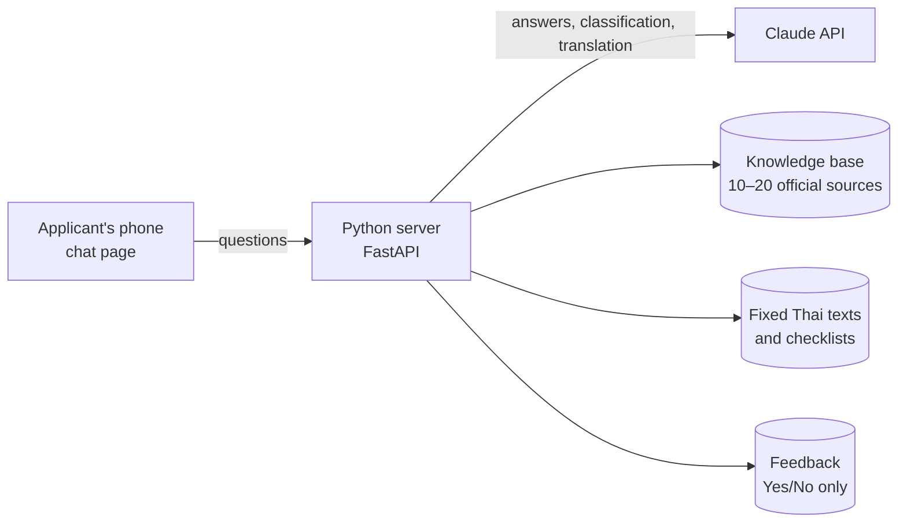
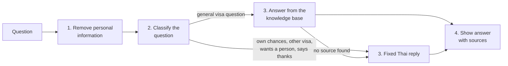

# Architecture Overview: Norway Visa Guide For Thai

This page explains how the chatbot is built and why. It is written for the IBE160 examiner and teacher. The binding technical rules are in [`ARCHITECTURE-SPINE.md`](architecture-G94-sikveland-2026-11-02/ARCHITECTURE-SPINE.md), and the decision log behind them is in that folder's `.memlog.md`. The requirements (FR/NFR) come from the [PRD](../prds/prd-G94-sikveland-2026-10-19/prd.md).

## The system in one picture

The applicant opens a web page on their phone and asks questions in Thai. A small Python server answers them using Claude and a knowledge base of 10–20 official pages from UDI, VFS Global, the Royal Norwegian Embassy and the EU's Schengen pages. For the course, the server runs on a laptop; publishing it online is outside the MVP.

## How a question becomes an answer

Every question goes through the same four steps, always in this order:

1. **Remove personal information.** Passport numbers, Thai ID numbers and phone numbers are deleted before anything is sent to the AI service. The applicant gets a reminder not to share them, and the rest of the question is still answered.
2. **Classify.** A small, cheap model (Claude Haiku 5.5) sorts the question into one of five categories: a general question; a question about the applicant's own chances ("will I get the visa?"); a question about another visa type; a request to talk to a person; or a sign the applicant is done ("thank you").
3. **Answer or reply.** Only general questions go to the large model (Claude Opus 5.5), which answers from the knowledge base and must point to the exact source text it used. Everything else gets a fixed Thai text that the adviser has checked. For example, questions about the applicant's own chances get "only the embassy decides".
4. **Show the answer.** The answer appears bit by bit, as in other chat apps, with links to its sources underneath.

**Why a fixed pipeline?** Each step can be tested on its own, and the order guarantees that personal information is removed before anything leaves the server. The simpler alternative, one large prompt that does everything, would make the "only the embassy decides" reply depend on the model following instructions. Here it is guaranteed by code.

## How the chatbot avoids inventing answers

- **Only official sources.** The whole knowledge base is sent with every question, and Claude's *Citations* feature makes it quote the exact source text it relies on.
- **No source, no answer.** If an answer comes back without any source reference, it is thrown away before the applicant sees it, and the fixed reply "I can't find this in my sources" is shown instead, with the adviser's email.
- **Reviewed sources.** A script downloads the official pages and stores them in the repository. The adviser reviews every change before it is used, and the app never fetches web pages while running.
- **No search database.** Thai is written without spaces between words, which makes ordinary keyword search unreliable. With only 10–20 documents, sending all of them is simpler and more accurate. *Prompt caching* means the documents are not paid for in full on every question.

## Privacy by design

| What | Where it lives | Why |
| --- | --- | --- |
| The conversation | Only in the applicant's browser; deleted when the tab closes | The server never stores conversation text (NFR5) |
| Checklist ticks | Only on the applicant's phone | No account or login is needed, and ticks survive several days |
| Feedback | On the server: Yes/No, time and a random anonymous ID | Needed to measure success (SM-1); contains nothing personal |
| Personal information | Deleted before any processing | Never reaches the AI service or any log |

To understand follow-up questions ("and how much is the fee?"), the page sends the earlier messages along with each new question. The server uses them for that one answer and then forgets them.

## Fixed texts the adviser controls

Claude writes only the answers to general questions and the English translations. Every other text the applicant sees is written in advance and checked by the adviser (NFR8). That covers the "embassy decides" reply, the out-of-scope reply, the privacy notice, the feedback question, the example questions and the document checklists. Each fixed text is stored in Thai and English, so the "Show English translation" button costs nothing for these texts and also works in demo mode.

## Demo mode and testing

- **Demo mode** (`MOCK_LLM=true`) lets the examiner run the app without an API key. It answers the example questions with stored answers, sources and translations, and says politely that other questions need the full version.
- **Automated tests** run on every push in GitHub Actions. They use a scripted fake instead of Claude, so they are free, fast and never call the real API.
- **The test set** (20–30 Thai questions with expected answers and sources) runs against the real models after every change to prompts or sources. The results are stored in `eval/reports/` and show whether the PRD's quality targets are met: 90% correct with the correct source, and 100% correct handling of questions about the applicant's own chances.

## Technology

| Part | Choice |
| --- | --- |
| Server | Python 3.12, FastAPI, uvicorn |
| Chat page | Plain HTML, CSS and JavaScript, built for phones |
| AI models | Claude Opus 5.5 for answers; Claude Haiku 5.5 for classifying and translating (about 40 times cheaper for those steps) |
| Storage | SQLite for feedback only; files in the repository for sources, texts and checklists |
| Tests | pytest in GitHub Actions; an evaluation script for the test set |

Versions were checked against PyPI and Anthropic's documentation on 2 November 2026.

## Deliberately left for later

- Publishing the chatbot online (hosting, HTTPS), which is needed for the Facebook link and 24-hour availability.
- The visual design of the page, which belongs to the UX work.
- A response-time target, to be measured during development.
- Testing on real phones that streaming works in Facebook's in-app browser.
